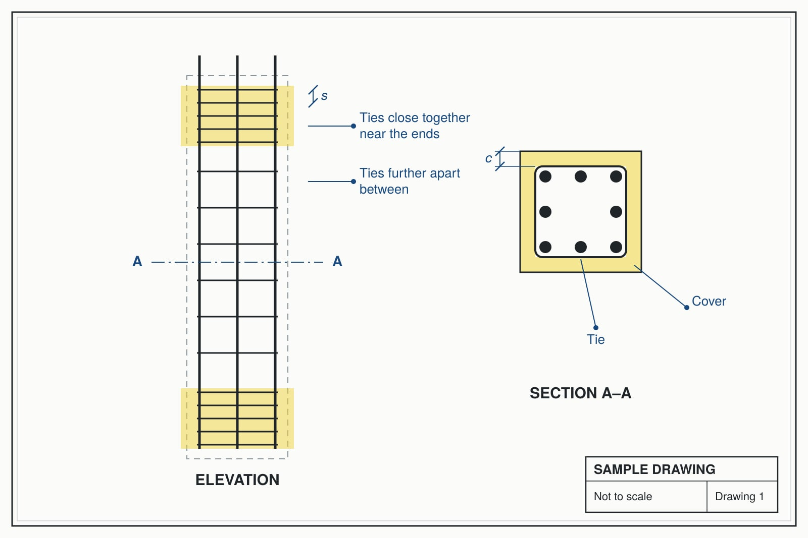
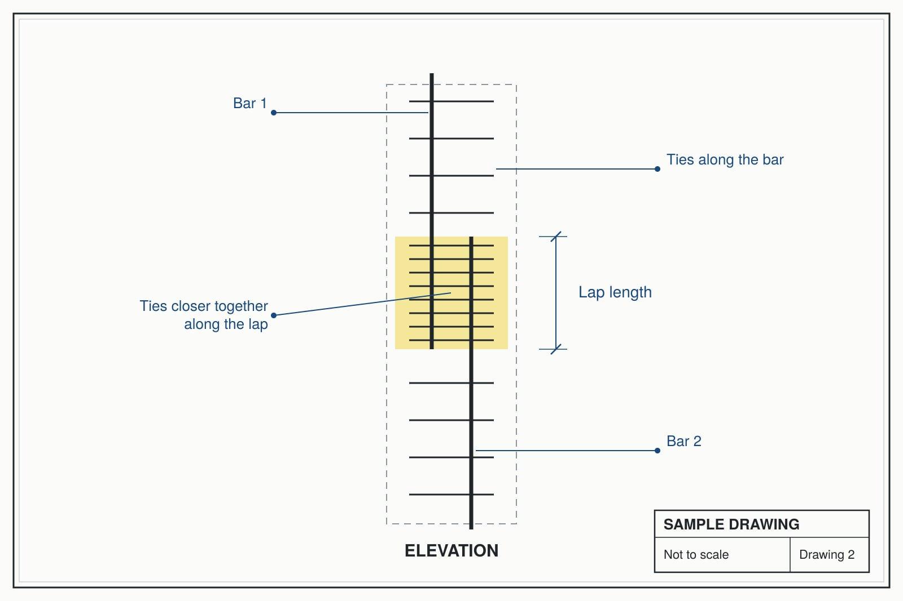
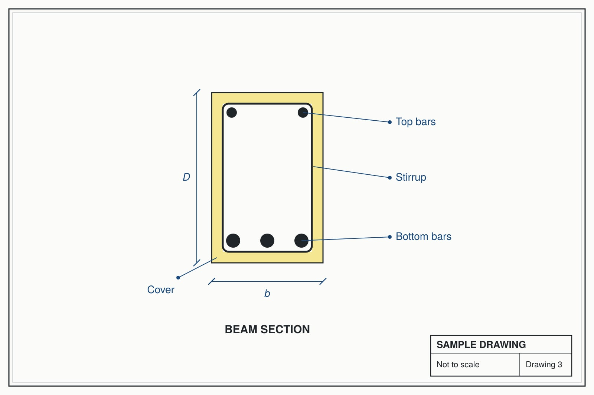

This is a sample. It shows how a site note reads once you publish one: a short text under each heading, and photographs that open full size when tapped. Replace it with your own, or delete it.

## What I saw

Say what is in front of you in plain words: the stage of work, what is being done, and by whom (roles, not names). Keep to one idea in each paragraph.

## What I checked

List what you measured or compared with the drawings, and what you found. A short list works well:

- The spacing of the ties against the drawing
- The cover between the bars and the face of the concrete
- The lap length where two bars are joined

## What I learned

End with what you would do differently, or what you want to find out next.
