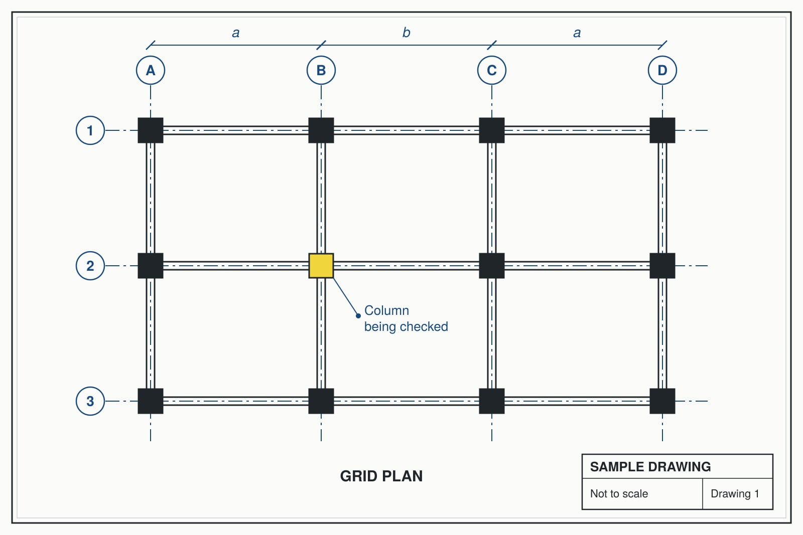
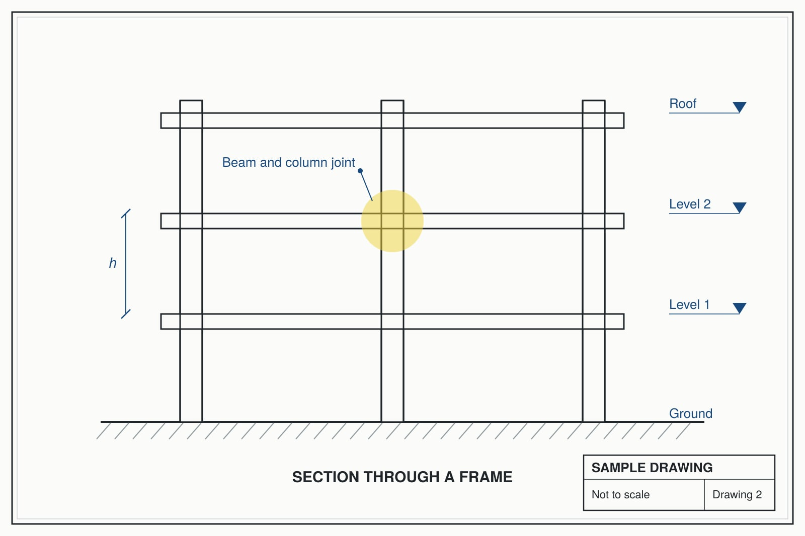

This is a sample. A project is a longer piece of work with a clear aim and a result, such as a quantity take-off, a schedule, a survey or a design exercise. Replace it with your own, or delete it.

## Aim

One or two sentences: what you set out to do, and why.

## Method

The steps you took, in order. Name the tools you used; they also appear in the title block beside the text.

## Result

What you found or made. Put a number or a picture here if you have one.

## What I would change

Be honest about what did not work, and what you would do next time.
